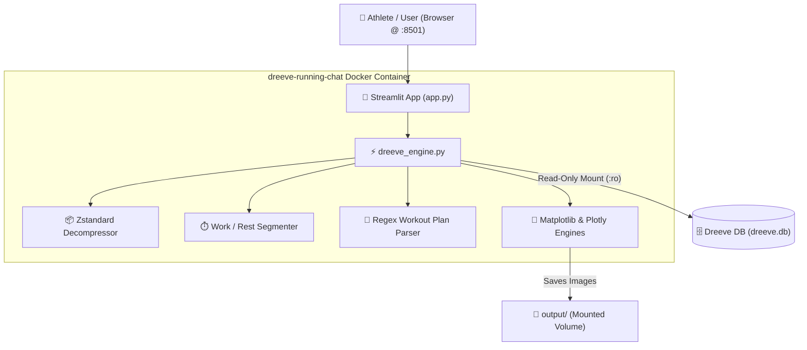

# Dreeve Running Chatbot & Telemetry Coach 🏃‍♂️💬

[](https://streamlit.io/)
[](https://www.docker.com/)
[](https://www.python.org/downloads/)
[](https://opensource.org/licenses/MIT)

An interactive, self-hosted web chatbot and running coach for [Dreeve](https://github.com/robiningelbrecht/dreeve) / Runwise fitness databases.

Built with **Streamlit** and containerized with **Docker**, it runs **100% locally on your server's CPU power** with **zero cloud dependencies, zero external LLM API costs ($0.00), and 100% data privacy**.

---

## 📸 Overview

The chatbot lets you talk directly to your running history and telemetry:
- **Natural Language Workout Queries**: Understands arbitrary interval plans (e.g. `1k warmup + 4x1K @6:15 with 90s walk + 0.5k cooldown` or `0.8k easy, 2x1.5k @ 6:00, 1k @ 7:00`) as well as auto-detection for unstructured runs.
- **Inline Telemetry Plots**: Renders publication-ready pace, heart rate, cadence, and elevation charts with work vs. recovery segments directly inside the chat window.
- **Cardiac Decoupling & Drift**: Inspects heart rate drift across kilometer splits.
- **Interactive Volume Graphs**: Visualizes weekly mileage and duration using interactive Plotly bar charts.
- **Quick Action Sidebar**: One-click prompt buttons, live database connection status, and custom interval plan builders.

---

## 🏛️ Architecture



---

## 🚀 Quickstart with Docker Compose

### 1. Clone the Repository
```bash
git clone https://github.com/JournalKenobi/dreeve-running-chat.git
cd dreeve-running-chat
```

### 2. Configure Environment & Mounts
Check `docker-compose.yml` to ensure the path points to your local `dreeve.db`:

```yaml
services:
  dreeve-running-chat:
    build: .
    container_name: dreeve-running-chat
    restart: unless-stopped
    ports:
      - "8501:8501"
    volumes:
      - /path/to/dreeve/storage/database:/data/database:ro
      - ./output:/app/output:rw
    environment:
      - DREEVE_DB_PATH=/data/database/dreeve.db
      - DREEVE_OUTPUT_DIR=/app/output
      - TZ=Asia/Kolkata
    networks:
      - homelab

networks:
  homelab:
    name: homelab
    external: true
```

### 3. Build & Run
```bash
docker compose up -d --build
```

### 4. Open in Browser
Navigate to **`http://localhost:8501`** (or your server's LAN IP).

---

## 💬 Sample Questions You Can Ask

* *"Analyze today's run: 1k warmup + 4x1K @6:15 with 90s walk + 0.5k cooldown"*
* *"Analyze interval session: 0.8k easy, 2x1.5k @ 6:00, 1k @ 7:00"*
* *"Show pace vs heart rate scatter plot"*
* *"Show cardiac drift across kilometer splits"*
* *"What is my weekly mileage breakdown?"*
* *"List my recent runs"*

---

## 🔒 Privacy & Performance

* **Zero Cloud Dependence**: Everything executes within the container. No data leaves your machine.
* **Pure CPU Speed**: Responses, split computations, and plots generate in sub-second time.
* **Safe Read-Only SQLite Access**: Mounted with `:ro` and queries use SQLite Write-Ahead Logging (`?mode=ro`) to prevent locks or database corruption.

---

## 📄 License

This project is licensed under the [MIT License](LICENSE).
