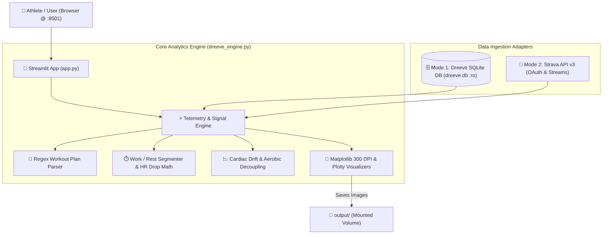

# Dreeve Running Chatbot & Telemetry Coach 🏃‍♂️💬

[](https://streamlit.io/)
[](https://www.docker.com/)
[](https://kernel.org)
[](https://apple.com)
[](https://www.python.org/downloads/)
[](https://opensource.org/licenses/MIT)

An interactive, self-hosted web chatbot and personal running coach. It analyzes workout telemetry, breaks down arbitrary interval plans, measures heart rate recovery drops, tracks cardiac drift across kilometer splits, and visualizes weekly training volume.

Runs **100% locally on your machine's CPU power** with **zero external LLM API costs ($0.00), zero cloud token usage, and 100% athlete data privacy**.

---

## 📸 Key Capabilities

* **Natural Language Interval Workout Parsing**: Accepts structured arbitrary workout plans like:
  * `"1k warmup + 4x1K @6:15 with 90s walk + 0.5k cooldown"`
  * `"0.8k easy, 2x1.5k @ 6:00, 1k @ 7:00"`
  * Fallback auto-detection for unstructured runs.
* **Inline Telemetry Plots**: Renders continuous pace, heart rate, cadence, and elevation telemetry with work vs. recovery segments directly inside the chat bubbles.
* **Cardiac Decoupling & Drift Progression**: Detects cardiovascular creep across kilometer splits to measure aerobic base development.
* **Aerobic Capacity Progression**: Compares early vs. late month training volume, average heart rate drops at identical distances, and pace-vs-heart-rate efficiency curves.
* **Interactive Volume Graphs**: Visualizes weekly mileage and active duration with responsive Plotly bar charts.
* **Dual Data Source Support**:
  1. **Mode 1**: Local [Dreeve](https://github.com/robiningelbrecht/dreeve) SQLite Database (`dreeve.db`).
  2. **Mode 2 (Path 2)**: **Strava API v3 Live Integration** for users who track runs on Strava without self-hosting Dreeve.

---

## 🏛️ Architecture



---

## 🔌 Path 2: Strava API v3 Integration Guide (For Non-Dreeve Users)

If you don't self-host Dreeve and track all your activities directly on **Strava**, you can connect the chatbot directly to Strava's official API to pull activities and second-by-second sensor streams (`time`, `distance`, `heartrate`, `cadence`, `altitude`).

### Step 1: Create a Free Strava Developer Application
1. Log into your account at **[Strava API Settings](https://www.strava.com/settings/api)**.
2. Fill out the application form:
   * **Application Name**: `Running Coach Chatbot`
   * **Category**: `Personal / Analytics`
   * **Club**: *(Leave empty)*
   * **Website**: `http://localhost:8501`
   * **Authorization Callback Domain**: `localhost`
3. Click **Create**. You will see your **Client ID** and **Client Secret**.

### Step 2: Authorize & Obtain a Refresh Token
By default, Strava tokens only grant `read` access. To allow the chatbot to inspect your private activities and detailed telemetry streams, you need the `activity:read_all` permission scope:

1. Replace `YOUR_CLIENT_ID` in the URL below with your actual Client ID, then open it in your web browser:
   ```text
   https://www.strava.com/oauth/authorize?client_id=YOUR_CLIENT_ID&response_type=code&redirect_uri=http://localhost/exchange_token&approval_prompt=force&scope=read,activity:read_all
   ```
2. Click **Authorize** on the Strava consent screen.
3. Your browser will redirect to an address like:
   ```text
   http://localhost/exchange_token?state=&code=AUTHORIZATION_CODE_HERE&scope=read,activity:read_all
   ```
   Copy the `AUTHORIZATION_CODE_HERE` from your browser's address bar.

4. Open your terminal and run this `curl` command (substituting your values) to exchange the temporary code for a permanent `refresh_token`:
   ```bash
   curl -X POST https://www.strava.com/oauth/token \
     -F client_id=YOUR_CLIENT_ID \
     -F client_secret=YOUR_CLIENT_SECRET \
     -F code=AUTHORIZATION_CODE_HERE \
     -F grant_type=authorization_code
   ```
5. The JSON response contains your `"refresh_token"`. Save your `Client ID`, `Client Secret`, and `Refresh Token`.

---

## 🐧 Setup Manual for Linux (Ubuntu, Debian, Fedora, Arch)

### Method A: Docker Deployment (Recommended)

1. **Install Docker & Docker Compose**:
   * **Ubuntu / Debian**:
     ```bash
     sudo apt update && sudo apt install -y docker.io docker-compose-v2
     sudo usermod -aG docker $USER && newgrp docker
     ```
   * **Fedora**:
     ```bash
     sudo dnf install -y moby-engine docker-compose-plugin
     sudo systemctl enable --now docker
     sudo usermod -aG docker $USER && newgrp docker
     ```
   * **Arch Linux**:
     ```bash
     sudo pacman -S docker docker-compose
     sudo systemctl enable --now docker
     sudo usermod -aG docker $USER && newgrp docker
     ```

2. **Clone & Configure**:
   ```bash
   git clone https://github.com/JournalKenobi/dreeve-running-chat.git
   cd dreeve-running-chat
   cp .env.example .env
   ```

3. **Select Your Mode in `.env`**:
   * **For Dreeve**:
     ```env
     DATA_SOURCE=dreeve
     DREEVE_DB_PATH=/path/to/your/dreeve.db
     ```
   * **For Strava (Path 2)**:
     ```env
     DATA_SOURCE=strava
     STRAVA_CLIENT_ID=123456
     STRAVA_CLIENT_SECRET=abcdef1234567890
     STRAVA_REFRESH_TOKEN=fedcba0987654321
     ```

4. **Launch with Docker Compose**:
   ```bash
   docker compose up -d --build
   ```

5. **Verify**:
   ```bash
   docker ps -f name=dreeve-running-chat
   curl -f http://localhost:8501/_stcore/health
   ```
   Open **`http://localhost:8501`** in your browser.

---

### Method B: Native Python Virtual Environment on Linux

If you prefer running directly on your host machine without Docker:

```bash
# 1. Install Python 3.11 & virtualenv tools
sudo apt install -y python3.11 python3.11-venv python3-pip

# 2. Clone repository & create venv
cd dreeve-running-chat
python3.11 -m venv .venv
source .venv/bin/activate

# 3. Install dependencies
pip install --upgrade pip
pip install -r requirements.txt

# 4. Set environment variables & run
export DREEVE_DB_PATH="/path/to/dreeve.db"
export DREEVE_OUTPUT_DIR="./output"

streamlit run app.py --server.port 8501 --server.address 0.0.0.0
```

---

## 🍏 Setup Manual for macOS (Apple Silicon M1/M2/M3/M4 & Intel)

### Method A: Docker Desktop for Mac (Recommended)

1. **Install Docker Desktop**:
   * Download and install from [docker.com/products/docker-desktop](https://www.docker.com/products/docker-desktop/) or install via Homebrew:
     ```bash
     brew install --cask docker
     ```
   * Open Docker Desktop from Applications to ensure the Docker daemon is active.

2. **Clone & Setup Environment**:
   ```bash
   git clone https://github.com/JournalKenobi/dreeve-running-chat.git
   cd dreeve-running-chat
   cp .env.example .env
   ```

3. **Configure Volumes in `docker-compose.yml`**:
   On macOS, file sharing permissions require paths under `/Users/yourusername`. Update the volume mapping:
   ```yaml
   volumes:
     - /Users/yourusername/path/to/dreeve.db:/data/database/dreeve.db:ro
     - ./output:/app/output:rw
     - ./app.py:/app/app.py:ro
     - ./dreeve_engine.py:/app/dreeve_engine.py:ro
   ```

4. **Build & Start**:
   ```bash
   docker compose up -d --build
   ```
   Navigate to **`http://localhost:8501`** in Safari or Chrome.

---

### Method B: Native Python on macOS (via Homebrew)

1. **Install Python 3.11**:
   ```bash
   brew install python@3.11
   ```

2. **Clone & Create Environment**:
   ```bash
   cd dreeve-running-chat
   python3.11 -m venv .venv
   source .venv/bin/activate
   ```

3. **Install Dependencies**:
   ```bash
   pip install --upgrade pip
   pip install -r requirements.txt
   ```

4. **Launch Streamlit**:
   ```bash
   export DREEVE_DB_PATH="/Users/yourusername/path/to/dreeve.db"
   export DREEVE_OUTPUT_DIR="./output"
   streamlit run app.py
   ```

---

## 💬 Sample Prompts to Try

* **Interval Workout Analysis**:
  * `"Analyze today's run: 1k warmup + 4x1K @6:15 with 90s walk + 0.5k cooldown"`
  * `"Analyze workout: 0.8k easy, 2x1.5k @ 6:00, 1k @ 7:00"`
* **Aerobic Capacity & Progression**:
  * `"Did my aerobic capacity improve in later weeks of October?"`
  * `"Compare early vs late October runs"`
* **Efficiency & Pacing Curves**:
  * `"Show pace vs heart rate scatter plot"`
  * `"Show 60-day performance dashboard"`
* **Cardiac Decoupling**:
  * `"Show cardiac drift across kilometer splits"`
* **Volume & History**:
  * `"What is my weekly mileage breakdown?"`
  * `"List my recent runs"`

---

## 🔒 Local Privacy & Concurrency

* **Zero External Telemetry**: Your GPS tracks, heart rates, and fitness data never leave your computer.
* **Safe Read-Only Database Connections**: The engine binds to SQLite with `?mode=ro` and uses Write-Ahead Logging (WAL). It will never corrupt or lock an active database.

---

## 📄 License

This project is licensed under the [MIT License](LICENSE).
