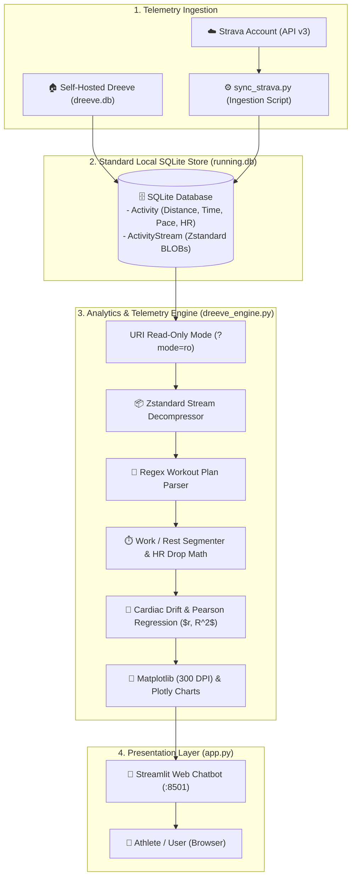

# 🚀 Complete Setup & Architecture Guide

A comprehensive, step-by-step manual explaining how the **Running Chatbot & Telemetry Coach** works, how to prepare your running database (from a local Dreeve DB or directly via the Strava API), and how to launch the application using **Docker** or **Native Python** on Linux and macOS.

---

## 🧠 Part 1: How It Works Under the Hood

Unlike typical AI chatbots that send your private fitness data to cloud Large Language Models (LLMs), this system is built on **Deterministic Signal Processing and Local Computing**:



### The 4-Stage Execution Pipeline:
1. **Ingestion**: Your runs are pulled either from an existing local Dreeve database or synced from Strava using `sync_strava.py`. Second-by-second sensor streams (`time`, `distance`, `heartrate`, `cadence`, `altitude`) are stored as compressed binary blocks.
2. **Intent Parsing**: When you type a query (e.g., *"Analyze: 1k warmup + 4x1K @6:15 with 90s walk"*), the engine parses your target intervals, paces, and rest durations without calling external cloud APIs.
3. **Signal Processing & Micro-Splits**: The engine decompresses the raw sensor stream, segments the workout into work and recovery intervals, measures target pace deltas, and calculates physiological metrics like **heart rate recovery drop** (e.g. $-28\text{ bpm}$ during walk breaks).
4. **Instant Rendering**: Visualizations and markdown tables render in milliseconds directly in your browser.

---

## 🗄️ Part 2: Preparing Your Running Database

You only need **ONE** of the following data sources:

### Option A: You Already Self-Host Dreeve
If you already run [Dreeve](https://github.com/robiningelbrecht/dreeve) on your server or homelab, your database is already ready!
* Your SQLite file is located at: `/path/to/dreeve/storage/database/dreeve.db`.
* You can skip directly to **Part 3**!

---

### Option B: You Track Runs on Strava (No Dreeve Required)
If you track runs using Garmin, Apple Watch, Coros, Polar, or smartphone apps that sync to **Strava**, you can create your local database in 3 minutes using our built-in sync script:

#### Step 1: Create a Free Strava Developer Application
1. Go to **[strava.com/settings/api](https://www.strava.com/settings/api)** and log into your Strava account.
2. Fill out the application fields:
   * **Application Name**: `Running Coach Chatbot`
   * **Category**: `Personal / Analytics`
   * **Club**: *(Leave blank)*
   * **Website**: `http://localhost:8501`
   * **Authorization Callback Domain**: `localhost`
3. Click **Create Application**.
4. Note your **Client ID** and **Client Secret**.

#### Step 2: Authorize `activity:read_all` Scope
1. Open this URL in your web browser (replace `YOUR_CLIENT_ID` with your actual Client ID):
   ```text
   https://www.strava.com/oauth/authorize?client_id=YOUR_CLIENT_ID&response_type=code&redirect_uri=http://localhost/exchange_token&approval_prompt=force&scope=read,activity:read_all
   ```
2. Click **Authorize** on Strava.
3. Your browser will redirect to an address like:
   ```text
   http://localhost/exchange_token?state=&code=AUTHORIZATION_CODE_HERE&scope=read,activity:read_all
   ```
4. Copy the `AUTHORIZATION_CODE_HERE` from your browser's address bar.

5. In your terminal, exchange this code for a permanent `refresh_token`:
   ```bash
   curl -X POST https://www.strava.com/oauth/token \
     -F client_id=YOUR_CLIENT_ID \
     -F client_secret=YOUR_CLIENT_SECRET \
     -F code=AUTHORIZATION_CODE_HERE \
     -F grant_type=authorization_code
   ```
6. The JSON response will contain your `"refresh_token"`.

#### Step 3: Run the Sync Script to Build Your Local Database
1. Copy `.env.example` to `.env`:
   ```bash
   cp .env.example .env
   ```
2. Open `.env` and fill in your credentials:
   ```env
   DATA_SOURCE=strava
   STRAVA_CLIENT_ID=123456
   STRAVA_CLIENT_SECRET=abcdef1234567890
   STRAVA_REFRESH_TOKEN=fedcba0987654321
   RUNNING_DB_PATH=running.db
   ```
3. Run the sync utility:
   ```bash
   python sync_strava.py
   ```
*The script automatically fetches your recent runs, pulls the second-by-second sensor streams, compresses them with Zstandard, and creates a clean `running.db` file.*

---

## 🚀 Part 3: Launching the Chatbot

Choose the deployment method that fits your environment:

---

### Method 1: Docker Deployment (Linux & macOS)

Docker packages Python, all scientific libraries (`numpy`, `scipy`, `pandas`, `matplotlib`), font libraries, and Streamlit into a self-contained container.

#### 1. Copy Environment Configuration
```bash
cp .env.example .env
```
Edit `.env` to set your `DREEVE_DB_PATH` or Strava credentials. In `docker-compose.yml`, `env_file: .env` is automatically mounted.

```yaml
services:
  dreeve-running-chat:
    build: .
    container_name: dreeve-running-chat
    restart: unless-stopped
    env_file:
      - .env
    ports:
      - "8501:8501"
    volumes:
      # If using Dreeve:
      - ${DREEVE_DB_DIR:-../dreeve/storage/database}:/data/database:ro
      # OR if using Strava running.db:
      # - ./running.db:/data/database/dreeve.db:ro
      - ./output:/app/output:rw
      - ./app.py:/app/app.py:ro
      - ./dreeve_engine.py:/app/dreeve_engine.py:ro
    environment:
      - DREEVE_DB_PATH=/data/database/dreeve.db
      - DREEVE_OUTPUT_DIR=/app/output
      - TZ=Asia/Kolkata
```

#### 2. Start the Container
```bash
docker compose up -d --build
```

#### 3. Access in Browser
Open **`http://localhost:8501`** (or your server's LAN IP).

---

### Method 2: Non-Docker / Native Python Deployment (Linux & macOS)

If you don't want to use Docker, you can run directly inside a standard Python 3.11 virtual environment.

#### 1. Install Python 3.11
* **On Linux (Ubuntu/Debian)**:
  ```bash
  sudo apt update && sudo apt install -y python3.11 python3.11-venv python3-pip
  ```
* **On macOS (via Homebrew)**:
  ```bash
  brew install python@3.11
  ```

#### 2. Create Virtual Environment & Install Dependencies
```bash
# Navigate to the repo directory
cd Running-analytics-chatbot

# Create and activate virtual environment
python3.11 -m venv .venv
source .venv/bin/activate

# Upgrade pip and install requirements
pip install --upgrade pip
pip install -r requirements.txt
```

#### 3. Launch the Chatbot
Copy `.env.example` to `.env` and set your database path, then launch Streamlit:

```bash
cp .env.example .env
# Edit .env to set your DREEVE_DB_PATH (e.g. /path/to/running.db or /path/to/dreeve.db)

streamlit run app.py --server.port 8501
```

Open **`http://localhost:8501`** in your browser.

---

## 💬 Part 4: How to Chat with Your Running Coach

Once the web interface opens, the sidebar will show 🟢 **Connected to DB** with your total run count.

### Sample Prompts You Can Ask:

| Category | Example Question |
| :--- | :--- |
| **Interval Analysis** | *"Analyze today's run: 1k warmup + 4x1K @6:15 with 90s walk + 0.5k cooldown"* |
| **Variable Pacing** | *"Analyze workout: 0.8k easy, 2x1.5k @ 6:00, 1k @ 7:00"* |
| **Aerobic Capacity** | *"Did my aerobic capacity improve in later weeks of October?"* |
| **Efficiency Curves** | *"Show pace vs heart rate scatter plot"* or *"Show dashboard"* |
| **Cardiac Drift** | *"Show cardiac drift across kilometer splits"* |
| **Training Mileage** | *"What is my weekly mileage breakdown?"* |
| **Activity Feed** | *"List my recent runs"* |

---

## 🔒 Privacy & Data Sovereignty Guarantee

* **No Cloud AI / No Third Parties**: All mathematical parsing and telemetry computations run strictly on local CPU.
* **Read-Only SQLite Attachment**: Database connections use SQLite `?mode=ro` with Write-Ahead Logging (WAL) to guarantee zero file locking or risk of database corruption.
